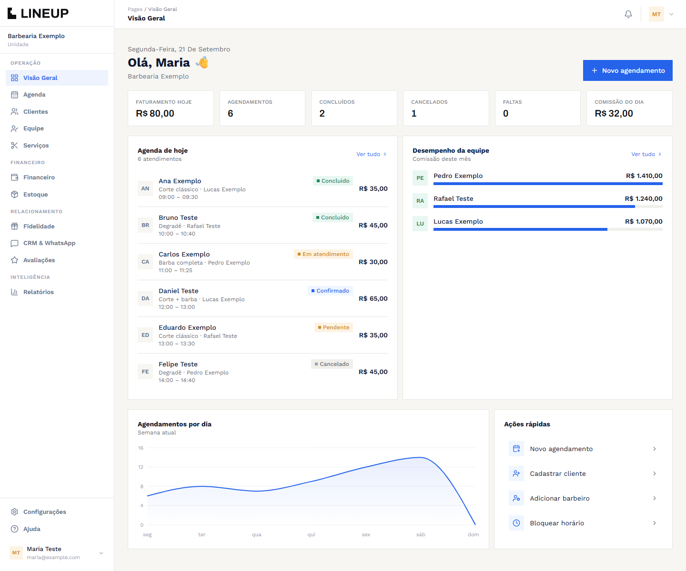
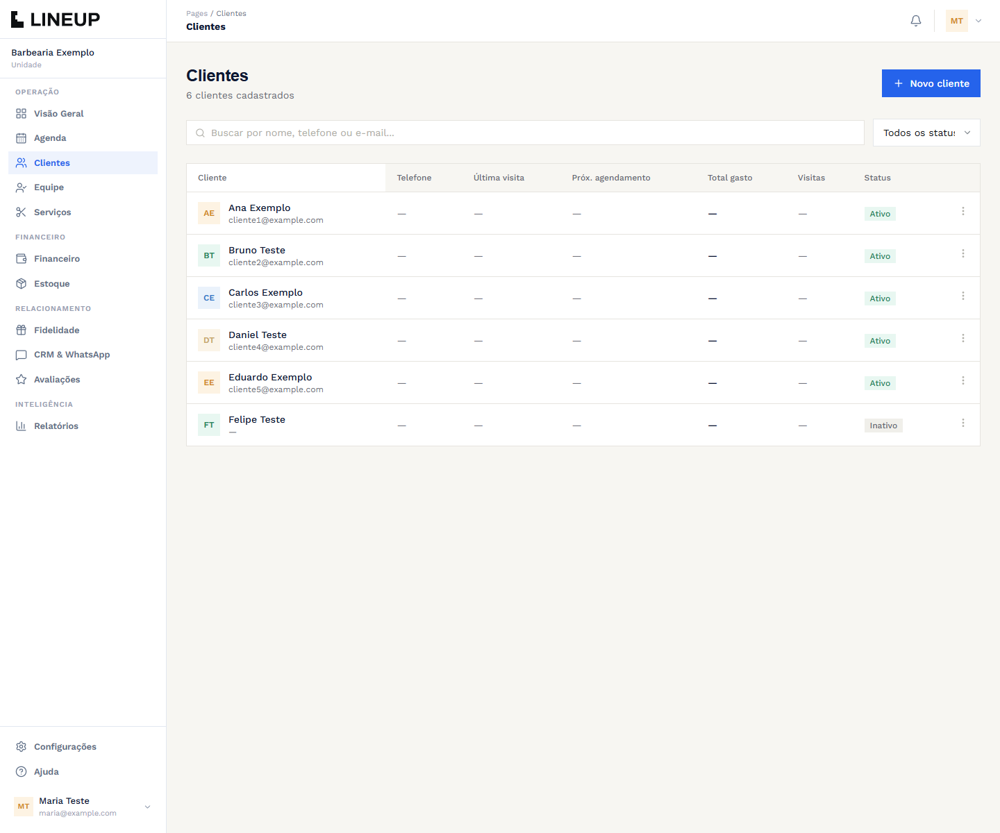
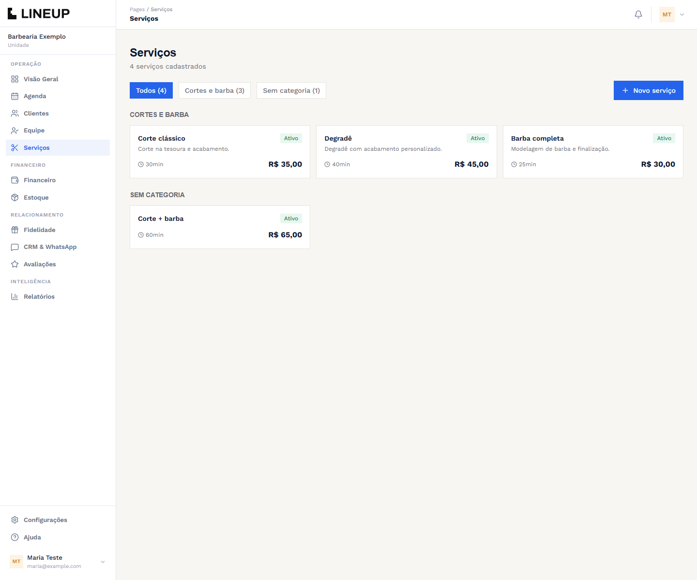

<div align="center">

# LINEUP — Gestão SaaS de Barbearias

<p align="center">
  
  
  
  
  
</p>

**Agenda, clientes, equipe e finanças em uma plataforma para barbearias e profissionais autônomos.**



</div>

Sistema SaaS multi-tenant para **agendamento, gestão operacional e financeira de barbearias e profissionais autônomos**, integrando backend corporativo em **Spring Boot** com frontend dinâmico em **Next.js**.

[Documentos do projeto](https://drive.google.com/drive/u/0/folders/1A0dUnrlsAg9sr15sGXIrUMwdVVaZ_QyZ) · [Apresentação](https://canva.link/i6oe8ur7mc9hkcr)

## Telas

Capturas da interface em ambiente isolado, com dados inteiramente fictícios e sem conexão com serviços externos. O painel acima reúne a agenda e os indicadores da barbearia.

### Clientes



Consulta de clientes com busca e filtro de status, incluindo cadastro sem foto ou e-mail.

### Serviços



Catálogo de cortes, barba e combos com preço, duração e organização por categoria.

---

## 🌟 Funcionalidades

- 📅 **Agendamento Inteligente**: Gestão de horários de barbeiros com prevenção de conflitos.
- 👥 **Gestão de Clientes e Histórico**: Perfil completo do cliente com preferências e histórico de cortes.
- 💳 **Módulo Financeiro**: Registro de transações, comissões de profissionais e relatórios de faturamento.
- 🔐 **Autenticação & Segurança**: Controle de acesso seguro por roles com JWT e Spring Security.
- 🐳 **Ambiente Unificado**: Suporte a execução de todos os módulos via Docker Compose.

---

## 🏗️ Estrutura do Ecossistema

```
varthex-barber/
├── backend/              # API RESTful Spring Boot 4 (Java 21)
│   ├── src/main/java/    # Controladores, Serviços, Segurança e Entidades
│   ├── Dockerfile
│   └── pom.xml
├── frontend/             # Interface Web / Painel Next.js & React
├── docs/                 # Documentação técnica e especificações
├── docker-compose.yml    # Orquestração dos containers
└── CONTRIBUTING.md
```

---

## 🚀 Como Executar

### Via Docker Compose

Com Docker e Docker Compose instalados:

1. Copie [frontend/.env.local.example](frontend/.env.local.example) para `frontend/.env.local`.
2. Preencha `NEXTAUTH_SECRET` com um segredo gerado para seu ambiente. O arquivo de exemplo descreve as integrações opcionais com Google e Resend.
3. Na raiz do projeto, execute:

```bash
docker compose up --build
```

- **Painel Web**: `http://localhost:3000`
- **Backend API**: `http://localhost:8080`
- **Swagger UI** (documentação interativa da API): `http://localhost:8080/swagger-ui/index.html`

---

## 📄 Licença

Software proprietário. Todos os direitos reservados — distribuição não autorizada.

---

<p align="center">Desenvolvido por <a href="https://github.com/arthurtvrs10">Arthur Tavares</a></p>
